# Adaptive Educational Text Simplification using LLMs: project report
_2026-11-26_

## Summary
24 real simplifications (8 passages x 3 levels) with `gemini-3.5-flash-lite`, prompt `2026-10-23.3`. 89 API requests, 192 seconds.

> Screenshots 1 to 11 and the phone view use demo (mock) data: invented example numbers, not results. Real results are in `results/experiment_gemini-3.5-flash-lite.jsonl`.

## Results by level

| Level | Runs | PASS | FAIL | NOT RUN | No text | Readability (source to output) | Mean change | Similarity | Words out/in | Attempts | Requests |
|---|---|---|---|---|---|---|---|---|---|---|---|
| Beginner | 8 | 7 | 1 | 0 | 0 | 49.1 to 64.3 | 15.2 | 0.98 | 1.05x | 1.4 | 36 |
| Intermediate | 8 | 5 | 1 | 1 | 1 | 46.1 to 53.1 | 7.0 | 0.98 | 0.99x | 1.9 | 28 |
| Advanced | 8 | 7 | 0 | 1 | 0 | 49.1 to 0.7 | -48.4 | 0.96 | 0.88x | 1.1 | 25 |

## Findings

- **23 of 24 runs produced text**; 19 passed every check, 2 failed a check and 2 could not complete verification (a Gemini server error interrupted the run). 1 run produced no usable text at all.
- **Beginner made text easier to read:** mean Flesch Reading Ease rose from 49.1 to 64.3 (+15.2), easier in 8 of 8 runs. **Intermediate** improved less (+7.0, easier in 6 of 7).
- **Advanced did not simplify by this measure:** mean readability fell from 49.1 to 0.7. This follows from its prompt (concise, precise academic wording with the technical terms kept) and the fact that the Advanced level has no simplification target. It is a design question for the project, not a measurement error: the example below shows the actual text.
- **Embedding similarity stayed high in every run that produced text:** the means were 0.98 (Beginner), 0.98 (Intermediate) and 0.96 (Advanced). Because the score is (cosine + 1) / 2, values near 1 are expected, and similarity does not prove that the meaning or the facts were kept.
- **Intermediate often returned text that was unchanged or empty:** All 5 MODEL_OUTPUT_INVALID errors (the model returned empty or unchanged text) occurred at the Intermediate level. In one run all three attempts did, so no text was produced.
- **Both FAIL results are probably false alarms:** the local check for numbers and terms failed because the model wrote numbers as words ("seven to nine" instead of "7 and 9", "two percent" instead of "2 percent"). The meaning was kept. The checker should treat number words as equal to digits; it was not changed during the experiment so the results stay valid.

## Limitations

- One model (gemini-3.5-flash-lite), one run per passage and level, 8 short passages: too small to draw statistical conclusions.
- The default model gemini-3.8-flash and gemini-3.5-flash were overloaded (HTTP 503/504) on the day of testing, which is why the lite model was used.
- Flesch Reading Ease and embedding similarity are automatic proxies. They do not prove that a learner understood the text. No human evaluation has been done yet.
- Gemini reviews its own output with the same model family, so its verdicts may share the model's blind spots.
- The passages were written for this project and are short general-knowledge texts; results on textbook or specialist material may differ.
- Free-tier Gemini content may be used by Google to improve its products, so only non-sensitive text was sent.

## Next steps

1. Make the numbers check treat number words and digits as equal, then re-run the affected cases.
2. Decide with the team what Advanced should mean, and whether it needs a different target than readability.
3. Investigate why Intermediate returns unchanged text, for example by strengthening its prompt or retrying with feedback.
4. Add a larger dataset, repeat each run several times, and compare against a plain one-shot prompt as a baseline.
5. Add human evaluation (simplicity, meaning preservation, fluency) and report agreement between raters.
6. Compare more than one model, including a locally run open model.

## Screenshots

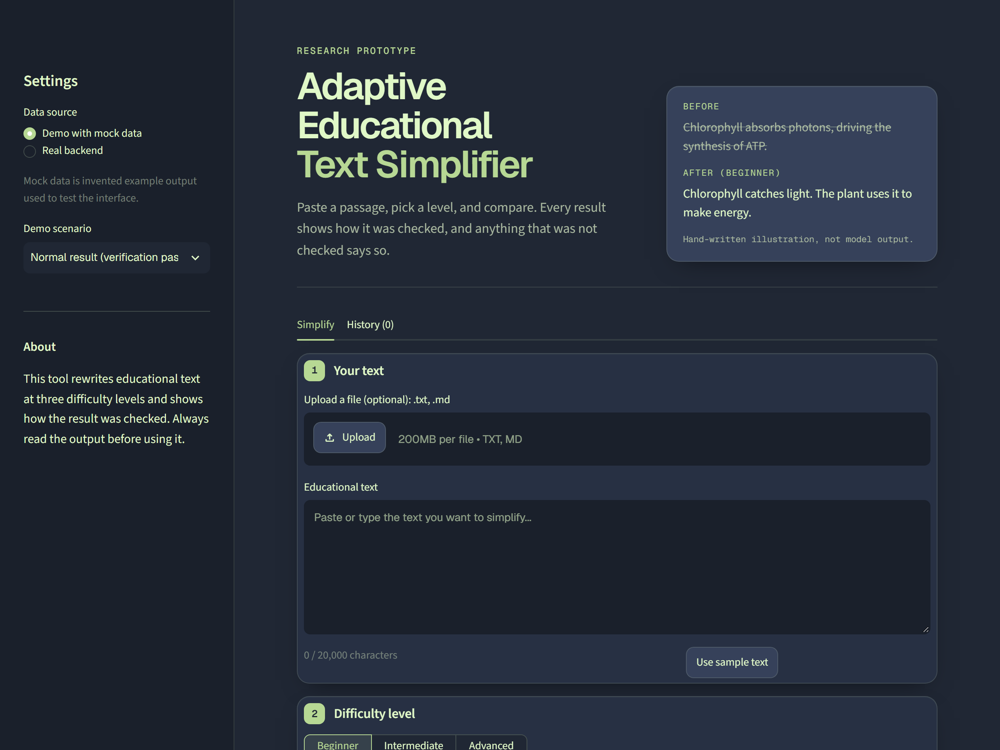
*Home screen and input.* Demo mode. The example in the header is a hand-written illustration, not model output.

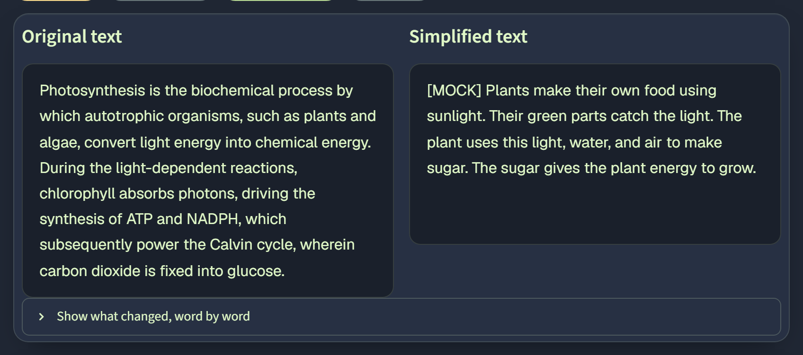
*Result: original and simplified text.* Demo (mock) data, labelled MOCK DATA. The numbers and texts are invented examples.

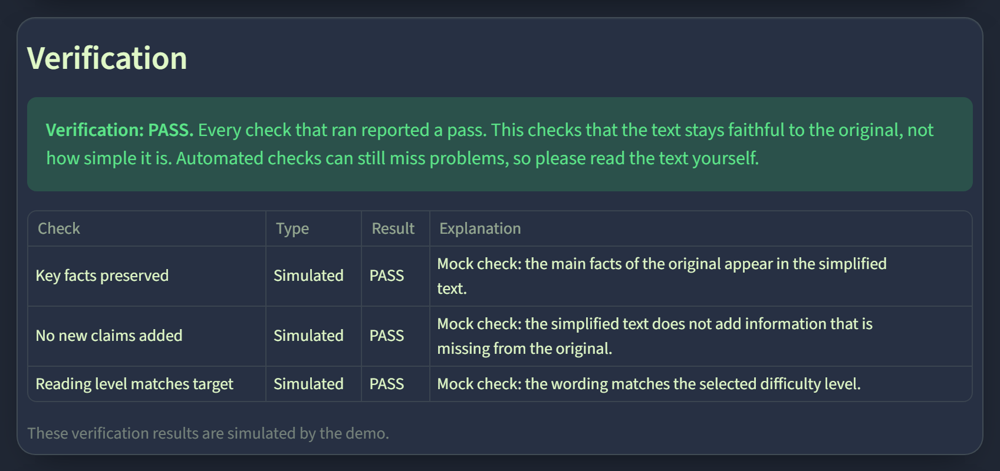
*Verification table with check types.* Demo data. The Type column says where each check runs; in demo mode every check is 'Simulated'.

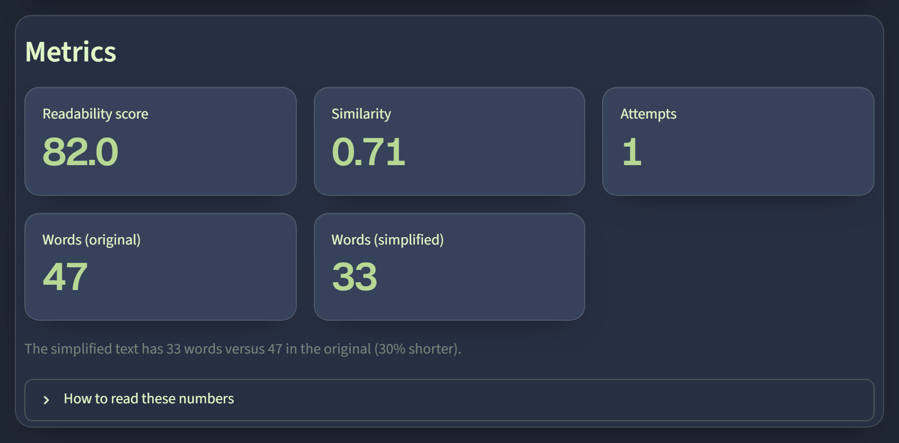
*Metrics.* Demo data. Readability, similarity, word counts and attempts.

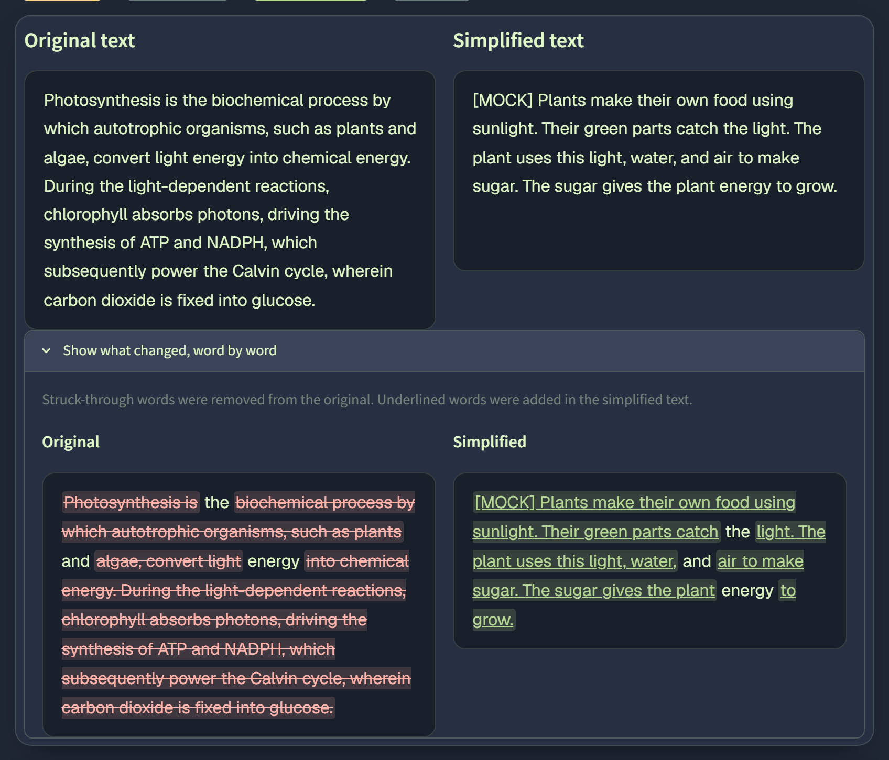
*Word-by-word comparison.* Struck-through words were removed, underlined words were added.

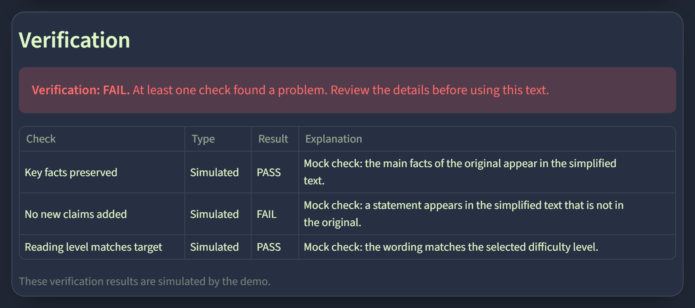
*A failed verification.* Demo scenario. The overall status is FAIL and the failing check is shown.

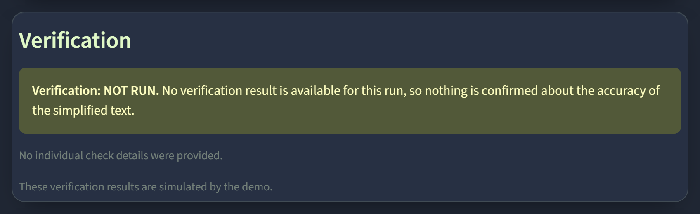
*Verification not run.* Demo scenario. The app says nothing was verified and never shows PASS.

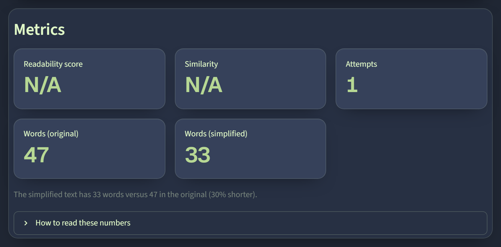
*Missing metrics show as N/A.* Demo scenario. A missing value is never shown as zero.

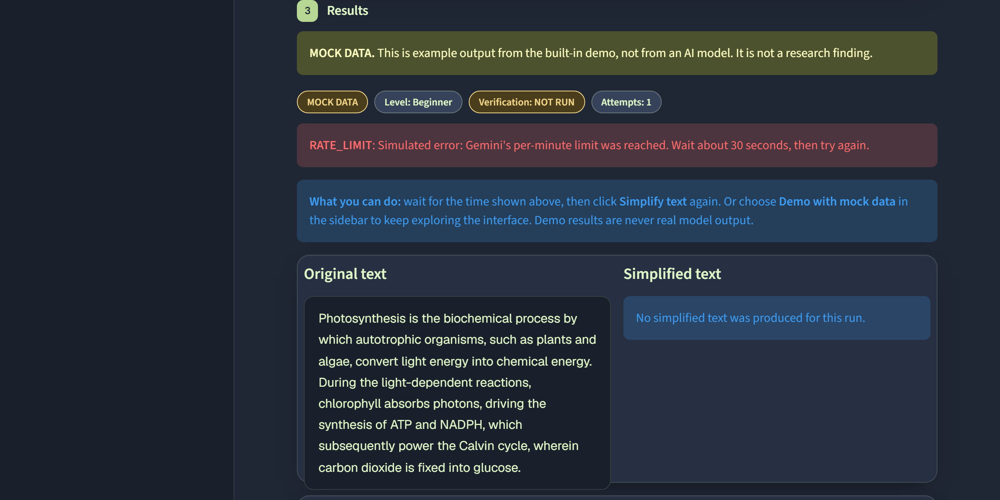
*Quota error handled clearly.* Demo scenario. The error, advice on what to do, no simplified text, and NOT RUN.

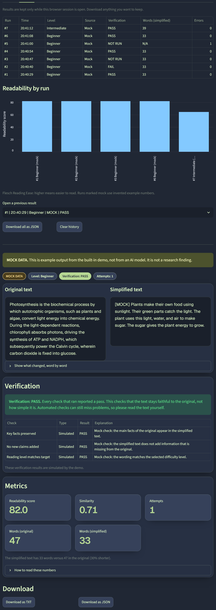
*Session history and readability chart.* Demo runs; the chart labels each run as mock.

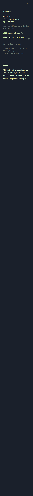
*Real-backend settings.* The reuse and demo-fallback switches and the .env status (setting names only).

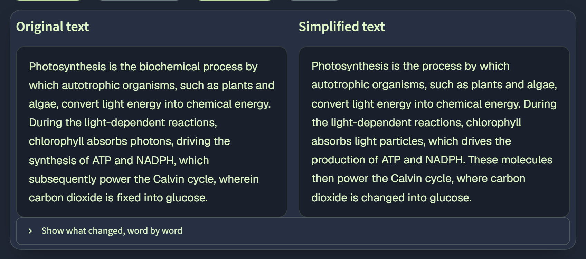
*A real Gemini result (Intermediate).* Real backend, gemini-3.5-flash-lite, sample text.

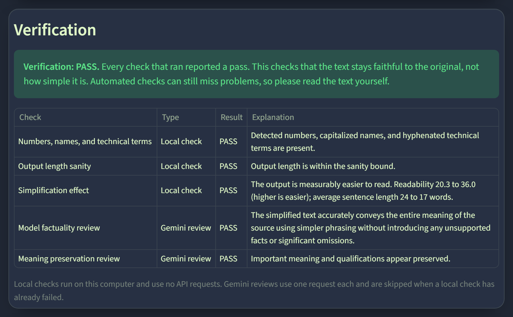
*Real verification with check types.* Three local checks (no API request) and two Gemini reviews.

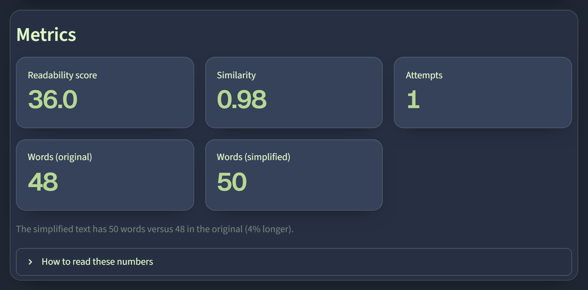
*Real metrics.* Computed from the real result.

*Repeat click reuses the saved result.* Second click with the same text and level: REUSED RESULT, no new API requests.

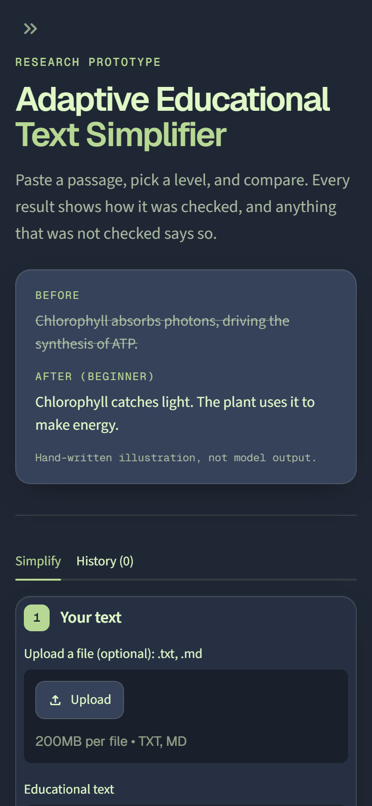
*Phone-sized view.* Demo mode at 390 px width.

